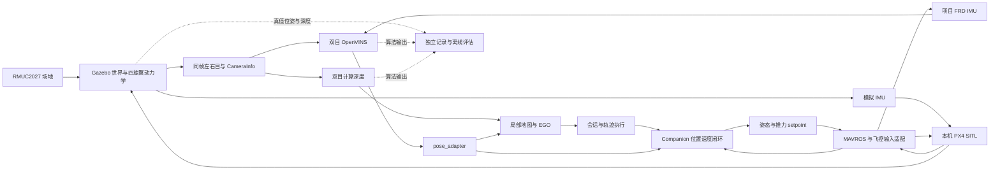

# SIH、Gazebo 与回放基准

WSL Ubuntu 24.04、ROS 2 Jazzy、Gazebo Harmonic。带飞控的仿真入口只连接本机 SITL，传感器台不连接飞控；数据与日志写入显式指定的新目录。

## RMUC2027 分支架构

适用 `sim/gab-map-validation-20261029`。下文是本分支的实现约束与执行顺序；当前完成项见 [STATUS](../../../../docs/STATUS.md#实现默认入口部署与验收)，首轮数据见 [10-29 记录](../../../../docs/history/STATUS_2026-10.md#2026-10-29-rmuc2027-gazebo-地图仿真分支)。尚未实现的入口和配置在表中标为“拟新增”。

### 目标与两条运行链

分支目标：在 RMUC2027 地图上验证项目自己的“同帧双目＋飞控 IMU → 双目 VIO／稠密深度 → 局部地图／EGO → Companion 姿态控制 → PX4”闭环，逐层记录失败原因。地图用于生成视觉、碰撞和评估参考；不把地图网格或真值位姿直接提供给规划、定位或正常任务控制。



图为目标闭环，不代表现有 capture/replay 已实现这些连线。PX4 到 Gazebo 的边是模拟器内部执行器接口；Companion 仍只发送高层姿态／推力，不输出 PWM/DShot。

| 运行模式 | 用途 | 运动与输入 | 控制边界 |
| --- | --- | --- | --- |
| `sensor_rig` | 图像、标定、同步、VIO、深度排查；保留现有 capture/replay/evaluate | 现有无重力力驱动传感器台；Gazebo 原生 IMU；先录后回放 | 不启动 PX4/EGO 飞行控制；通过也只代表感知基准 |
| `flight`（拟新增） | 起飞、规划、避障、到达、降落与故障停发 | 有重力四旋翼；Gazebo 负责运动和传感器；PX4 SITL 负责底层闭环 | 复用生产算法与会话门控，仿真专用启动；默认不自动开始任务 |

完整闭环只用一个动力学后端：Gazebo＋PX4 Gazebo 接口。已有 SIH 森林／Tag 测试保留为独立回归，不把 SIH 的运动、Gazebo 的相机和另一套地图混成同一闭环。官方 X500 仅用于接口对照；项目机体的质量、惯量、碰撞包络、推力模型未定义并验证前，不能宣称项目机体动力学通过。

### 模块与文件归属

继续使用现有包，不新增第二套 VIO、规划器、位置控制器或轨迹协议。仿真配置与适配器归 `boom_birds_sim`；通用行为修复才进入 sensing/control/bringup。

| 层 | 复用与拟新增内容 | 职责 |
| --- | --- | --- |
| 场地／模型 | `sim/assets/rmuc2027/`、`sim/worlds/rmuc2027.sdf`、`sim/config/arena/*.yaml`；机体 `sim/models/`（拟新增） | 场地来源／散列、起点、局部测试区域、机体／传感器安装；本分支收纳运行模型，原始 CAD／归档不复制入库 |
| 场景生成 | 现有 `gazebo_fixture.py`；`gazebo_arena.py`（已实现配置／资产校验） | fixture 保留传感器与标定生成；arena 负责外部场地、区域与模型组合；不在 fixture 中持续堆叠任务逻辑 |
| 仿真输入 | 现有 `gazebo_capture.py`；`gazebo_inputs.py`（拟新增） | 独占左右图配对、CameraInfo、编码、帧名和采样戳适配；flight 不依赖录包器转发实时输入 |
| 运行编排 | 现有 `gazebo_run.py`；`gazebo_session.py`（已实现感知采集编排） | 资源锁、进程所有权、启动状态机、超时、退出与结果清单；命令行薄封装 |
| 算法／任务 | sensing 的 depth/pose_adapter，OpenVINS，EGO，bringup 的 lifecycle，control 的 PX4 接口 | 保留现有职责、参数校验、执行许可及失效门控；不直接启动带 V4L2 输入的 hardware launch |
| 闭环入口 | `sim/launch/gazebo_navigation.launch.py`、`tools/run_gazebo_mission.sh`（拟新增） | 组合模拟输入、算法和本机 PX4；不修改实机默认入口；Mission.START 前不飞行 |
| 回放／评估 | 现有 replay/evaluate/matrix；按需扩展任务评估 | 回放发布白名单输入；真值只进入独立评估；每项给出 PASS/FAIL/NOT RUN |

表内 `sim/` 指 `companion/ros2_ws/src/boom_birds_sim/`。拟新增文件随相应阶段实现，不提前创建空壳。前视深度导航是本分支主线；下视 Tag、测距与返库沿用独立任务接口，在基础导航通过后再加入场景，不作为首轮全部启动的依赖。

### 文件目录与地图目标

以下目录已经落盘；上表中的新节点／闭环入口仍为拟新增，不创建空壳。

```text
boom_birds_sim/
├── assets/rmuc2027/
│   ├── models/rmuc2027_terrain/{model.config,model.sdf,meshes/}
│   ├── provenance/                      # 来源、许可与转换记录
│   ├── planning/                        # 几何检查脚本／结果、targets.png
│   ├── manifest.json                    # 82 个模型文件的 SHA256
│   └── README.md
├── worlds/
│   ├── rmuc2027.sdf                     # 场地、光照、物理系统；无无人机
│   └── rmuc2027_targets.sdf             # 调试预览，7 个无碰撞可视标记
├── config/arena/
│   ├── rmuc2027.yaml                    # 模型路径、坐标与范围
│   └── rmuc2027_scenarios.yaml          # 目标、相对偏移与故障用例
├── boom_birds_sim/
│   ├── gazebo_arena.py                 # 资产／场景校验、相对目标转换
│   ├── gazebo_session.py               # 受控感知启动与阶段编排
│   ├── gazebo_texture.py               # 可选表面纹理派生；几何／碰撞保留
│   ├── gazebo_fixture.py               # 现有传感器／标定生成
│   ├── gazebo_run.py                   # 现有 baseline/capture
│   ├── gazebo_capture.py
│   ├── gazebo_replay.py
│   └── gazebo_evaluate.py
└── launch/                             # 现有 SIH 等入口；Gazebo 闭环待实现
```

地图约 205 MiB，独立保留模型层级；世界使用 `model://rmuc2027_terrain`，不依赖 Windows 原件。构建安装清单包含 assets/worlds/config；构建及来源核验结果见 STATUS。模型来源和复制校验见[地图说明](assets/rmuc2027/README.md)。配置路径以包根为基准；session 已读取地图 YAML、校验目标 YAML 并使用 S00 参考位置。导航／故障用例仍为禁执行规划，尚未接入飞行运行器。`rmuc2027_targets.sdf` 为目标预览：7 个唯一位置用无碰撞球标记，蓝色为参考悬停点，绿色为一般目标，红色为绕障终点；模型名 target_00～target_06。该 world 只供调试展示，感知／闭环评估使用不带标记的 world，避免额外视觉特征。

候选参考悬停点 P0=`(-11,-4.5,1.5)`，以下坐标均为 `arena_world` 米制坐标；P0 不是接地出生位姿，z 不是离地高度。

| 用例 | 候选目标 | 验证目的 |
| --- | --- | --- |
| S00 静止 | P0 无位移 | 完整初始化、双目／IMU 时序与视觉更新 |
| S01 直行 | P0 → `(-9,-4.5,1.5)` | 2 m 跟踪、悬停与到达 |
| S02 侧移 | P0 → `(-11,-2.5,1.5)`，初始 yaw=0 | 2 m 侧向速度／坐标与观测覆盖 |
| S03 非零航向 | 同 S02 终点，初始 yaw=π/2 | 沿机头前进 2 m 的非零航向闭环 |
| S04 绕障 | `(-11.6,-2,1.0)` → `(-11.6,2,1.0)` | 直线经过地图现有高障碍，只给终点让 EGO 绕行 |
| S05 往返 | P0 → `(-7,-4.5,1.5)` → `(-7,-2.5,1.5)` → P0 | 分段目标、返程和原局部参考保持 |
| S06～S09 故障 | 基于 S01 | 深度停发、VIO 停发、时钟暂停／回跳 |

[目标图与离线几何检查](assets/rmuc2027/README.md#候选目标与几何检查)用于筛选场景，不代表轨迹、可见性或飞行通过。配置同时给出 `goal_offsets_start_flu_m`；运行时冻结 READY 的测量位置和水平航向后转换到原 VIO `global` 系，整个往返使用同一个参考。地图坐标和评估对齐不能成为真值控制输入；侧移与返程还需核验前视覆盖／偏航策略。

### 配置、坐标与时间契约

- 每次运行由一份场景配置解析并冻结运行配置：地图路径／散列、传感器尺寸与频率、K/D/基线／安装变换、机体档位、初始世界位姿、目标、随机种子、任务预算、故障计划及各构建前缀。字段与校验随实现落地，感知 session 已加载并校验场地配置、模型散列与目标坐标一致性；飞行任务配置加载器仍未实现。
- SDF 传感器、NPZ、Kalibr chain、pose_adapter 外参和 bridge 配置必须来自同一份几何定义；生成后逐项核对。目标档显式设置 `max_cameras=2/use_stereo=true`。现有 mono/noiseless 回放保留为诊断档，不能默认为双目或真实噪声验收；不用全局字符串替换隐式决定新档位。
- 地图世界系 `arena_world` 为米制 Z 向上；VIO 的 `global` 仍由估计器初始化，不设为真值原点。保存 `T_arena_global` 只供离线误差对齐。任务目标在原 VIO 局部系内给出；若需要场地坐标目标，必须另有显式、可验证的定位来源，不能读取评估变换下发目标。
- `body` 为 FLU；flight 的 `/boom_birds/imu` 按现有接口为 FRD，来自 PX4→MAVROS→IMU 适配；Gazebo 原生 IMU只接模拟器后端或独立诊断话题。当前 sensor_rig 的 FLU IMU及对应外参保持独立档位；切换到 FRD 时连同 `T_I_C0/T_I_B` 一起生成，禁止只翻 IMU 轴而保留旧外参。IMU 融合姿态不作为 VIO 输入。
- 左右图必须使用原始相同采样戳；不近似配对、不重写时间戳。深度为米制光轴 Z、32FC1／NaN，XYZ 同帧；无效、过期和未知观测不能清空地图。生产话题、速度所在坐标系与 QoS 以 [接口契约](../boom_birds_interfaces/config/contract.yaml) 为准。
- 每轮只有一个 `/clock` 发布源。Gazebo 运行和 bag 回放互斥；算法、EGO、会话、控制相关 ROS 节点显式核验 `use_sim_time`，不从 launch 参数存在推断节点已使用。采样配对／轨迹有效期用已对齐的仿真时域，进程启动／退出死锁保护用墙钟。
- flight 前必须核对 PX4 仿真时钟、MAVLink TIMESYNC／time_boot_ms、ROS Header 与控制器内部计时；当前墙钟定时器与超龄判断是否兼容低实时因子属于待验证项。先做暂停／恢复、倍速与回跳试验；回跳撤销会话并重启，不能静默修正旧轨迹。未通过前，不用放大控制超时解决约 0.088 的实时因子。
- PX4 的原生估计与后备链单独标注。模拟 GPS 可用于 `gnss_diagnostic` 接口对照，但不进入 Companion 的导航定位，也不能据此宣称无 GPS 返航／降落通过；无 GPS 后备光流／测距输入及 PX4 融合须另做场景和失效验证。

### 启动状态机与证据隔离

目标顺序为 `PREPARE → WORLD_PAUSED → INPUT_READY → STATIC_INIT → ESTIMATOR_READY → READY → RUNNING → STOPPING → CLOSED`；新 `session` 已实现感知采集的暂停加载、实际输入就绪及阶段触发；旧 `capture` 的固定 `sleep(2)` 仅保留为兼容入口，不满足此设计。

1. PREPARE：校验模型、配置、安装来源与本机端点；持有独立 ROS domain、GZ partition、PX4 instance／UDP 端口锁和新输出目录。完整闭环先用一个冻结安装闭包；拒绝缺包或混入旧 API，记录 Python 导入路径、ELF／插件来源和 Git／子模块 SHA。
2. WORLD_PAUSED：加载 world、渲染资源、ROS 桥、记录器及算法订阅；显式暂停。冷启动允许墙钟等待，但初始化与运动计时不能提前开始。
3. INPUT_READY：从图关系和受控步进实际确认两目、两份 CameraInfo、IMU、时钟及录包写入；只看到话题名称不算就绪。预热帧也记录，传感器台保持静止；flight 保持未解锁。
4. STATIC_INIT：输入齐备后从当前仿真时刻开始计静止窗口；后续运动以本轮阶段时刻为基准，替换绝对 5～40 s 自动激励。VIO 需实际初始化、视觉更新和新鲜状态；单纯 IMU 输出或首条 odom 不能代替。
5. READY：感知阶段允许启动预设台体运动；flight 还要求姿态参考、控制输入、PX4 未解锁状态及模式回读满足已有门控，然后等待显式 Mission.START。规划失败、过期输入和初始占用不能绕过。
6. STOPPING：撤销执行许可并记录停发；flight 正常收尾须独立确认 landed/disarmed，再退出本轮进程组。无回读或进程崩溃记异常，不能用杀进程表示降落成功；最终只清理由本轮创建的资源。

原始传感器与真值分开记录；至少保留 `inputs/`、`truth/`、`outputs/`、`logs/`、冻结配置与 `manifest.json`、`processes.json`、`evaluation.json`。回放器只允许发布图像、CameraInfo、IMU、时钟和该阶段显式需要的非真值状态；拒绝真值位姿、真值深度、全局碰撞网格进入算法域。现有把评估话题混在 inputs bag 的格式保留可读，新增格式再做物理分离与白名单检查。RViz 评估视图可叠加真值，但不能产生算法依赖。

### 分阶段交付与通过条件

| 阶段 | 交付 | 进入下一阶段的条件 |
| --- | --- | --- |
| A0 运行闭包与数据契约 | 配置校验、冻结前缀／来源清单、真值发布白名单、FLU/FRD／外参检查 | 输入源唯一，几何一致，旧 API 不混用；本机资源冲突可拒绝并清理 |
| A1 完整传感器采集 | 就绪握手、静止／运动分段、完整 bag、冷启动耗时与实时因子 | 从静止窗口开始录到完整请求时长；原图像／IMU门限及单调时间检查通过；暂停／重置行为明确 |
| A2 双目 VIO 与深度 | 显式双目档、实际视觉更新、独立轨迹误差、分距离／材质深度误差 | 沿用现有质量门限并记录配置；无尺度／时间拟合掩盖误差。单目仅保留对照，不代替双目主线 |
| A3 局部地图与 EGO | 回放及在线无控制规划，深度／位姿配对诊断、地图与轨迹记录 | 已知自由起点、可见障碍与未知区语义正确；有周期可执行轨迹及碰撞失效停发；不向 EGO 注入全场地图 |
| A4 PX4 Gazebo 控制对照 | 动力学与时钟接口、姿态参考、起飞／悬停／降落 | 先用独立显式控制对照排除 VIO/EGO变量，证据标注输入替身；真实算法闭环中替身全部关闭。位置／速度／航向响应与最终 landed/disarmed 均需实证 |
| A5 完整导航与故障 | 双目感知→EGO→Companion→PX4→Gazebo 的到达／降落与故障矩阵 | 无真值进入正常控制，轨迹／到达／碰撞／边界／失效后实际动作分别通过；同配置重复后保留逐轮结果，不能只取成功轮 |

A4 的最小启动／时钟／未解锁接口检查可在 A0 后单独准备；有动力运动与 A5 闭环须满足对应前置条件，不把 A4 控制对照当作 A2/A3 已通过。

场景按“小范围空旷运动 → 单障碍直行／侧向／非零航向 → 局部复杂通道 → 地图多区域”推进；每场景固定起点、目标、种子和允许的机体包络。故障至少覆盖单目丢帧、IMU／VIO／深度停发、规划撤销、setpoint 停发、模式确认失败、时钟回跳、PX4 重启与进程退出。每项同时记录 Companion 拒绝／停发和 PX4 后续状态，不用一种证明另一种。

感知采集的 45 s 不等于允许飞行 45 s。闭环任务区分工程诊断预算与规则评估预算，仍按 [规则基线](../../../../docs/RULE_BASELINE.md) 核对；不修改既有 30 s 规则口径或历史 45 s 工程测试决策。路径坐标、机体参数与新场景任务门限需在相应阶段固定，不在本规划中编造数值。

实现顺序固定为 A0、A1、A2、A3、A4、A5。阶段结果及当前阻塞只维护在 STATUS；上表作为进入下一阶段的条件，不随单例结果放宽。运行与回放命令见下节。

## 受控感知 session

`run_gazebo.sh session` 是本分支新的地图感知采集入口；不启动 PX4／EGO 或飞行任务。`--case perception_motion` 使用 S00 的参考位置并施加独立台体激励；`--case S00_static` 全程保持静止。导航目标配置的 execution_enabled 仍为 false，不能用此入口执行 S01～S09。

本轮使用独立复制的 Cyclone DDS／loopback 配置，激活路径由 `BB_GAZEBO_MIDDLEWARE_ENV` 指定；不修改系统默认 RMW。session 使用独立 ROS domain/GZ partition，先暂停启动 Gazebo，再受控步进（原生 Gazebo 时钟确认上一批完成后才排下一批）直到实际收到双目、两份 CameraInfo、IMU、深度真值、位姿真值和时钟。随后通过插件服务置位阶段原点：先静止 5 s，5～40 s 台体激励，末尾静止；计时不再从世界绝对 0 s 开始。记录完整请求时长；冷启动和采集分别用墙钟限制。session 使用地图模型生成本轮 `sensor_world.sdf`（world 名 bb_sensor），不直接运行无传感器的基础 world 文件。静止窗口是输入阶段，不等于 VIO 已初始化；实际视觉更新和质量另由 replay/evaluate 核对。

新录包格式把传感器留在 `inputs/`、真值放在 `truth/`；不发布真值 ROS 话题。replay 的输入白名单不变，evaluate 同时支持旧混合 bag 和新分离格式。现有单目／FLU 诊断档保留，新 session 显式生成双目／FLU 模拟标定；此输入不是正式 FRD 飞控链。

当前隔离构建批次为 `/home/waterc/bb_build/gab-map-validation-20261029/implementation-01/`，包含源快照、构建脚本与散列。构建和实测状态以 STATUS 为准。隔离运行需关闭源码覆盖，且指定运行根检查导入与 OpenVINS 来源：

```bash
# 在主工程根执行；要求该批次 install 已构建并通过来源核对。
export BB_GAZEBO_BUILD_ROOT=/home/waterc/bb_build/gab-map-validation-20261029/implementation-01
export BB_NAV_INSTALL=$BB_GAZEBO_BUILD_ROOT/install
export BB_OV_INSTALL=$BB_GAZEBO_BUILD_ROOT/install
export BB_GAZEBO_SOURCE_OVERLAY=0
export BB_GAZEBO_MIDDLEWARE_ENV=$BB_GAZEBO_BUILD_ROOT/middleware/activate.sh
export LIBGL_ALWAYS_SOFTWARE=1
bash companion/ros2_ws/tools/run_gazebo.sh session \
  --runtime-root "$BB_GAZEBO_BUILD_ROOT/install" \
  --root "$BB_GAZEBO_BUILD_ROOT/source" \
  --case perception_motion --duration 45 --headless-rendering \
  --out "$BB_GAZEBO_BUILD_ROOT/capture-NEW"
```

本轮脱机质量对照显式使用 `replay --rate 0.25`，预算档和 `--depth-profile fullres` 分别写入新输出目录，再执行 evaluate。该倍率是墙钟回放速度，不代表实时计算通过；同一 bag 的两次回放不是两个独立场景。门限与精确匹配真值方法不变，远场失败不能靠缩小评估范围改成 PASS。实际结果见[本轮记录](../../../../docs/history/STATUS_2026-10.md#2026-10-29-受控地图采集与双目回放)。

前台运行使用 `--gui`，可用 `--gui-config <文件>` 设置视角；与 `--headless-rendering` 互斥。本分支的地图俯视配置为 `config/gazebo/foreground_gui.config`。按用户要求，当前仿真运行须先检查后台与可用内存，确认没有并行采集／回放／构建，再以前台窗口运行；完整采集退出后才运行算法回放。

WSL＋NVIDIA 的前台命令（已激活同一隔离安装及私有 DDS 后执行）：

```bash
unset LIBGL_ALWAYS_SOFTWARE
export MESA_D3D12_DEFAULT_ADAPTER_NAME=NVIDIA
export GALLIUM_DRIVER=d3d12
export QT_QPA_PLATFORM=xcb
python3 -m boom_birds_sim.gazebo_session \
  --runtime-root "$BB_GAZEBO_BUILD_ROOT/install" \
  --root "$BB_GAZEBO_BUILD_ROOT/source" \
  --gui --gui-config "$BB_GAZEBO_BUILD_ROOT/install/boom_birds_sim/share/boom_birds_sim/config/gazebo/foreground_gui.config" \
  --duration 45 --out "$BB_GAZEBO_BUILD_ROOT/capture-GUI-NEW"
```

不能只凭窗口标题或进程存在判断可见；需看到实际地图画面。WSLg 标题含 `[WARN:COPY MODE]` 且窗口透明时，先检查 `/mnt/shared_memory` 和 weston.log；本机的临时修复是创建该目录并挂载 128 MiB tmpfs，未改 fstab 或 WSL 全局配置。依据与实测见[前台记录](../../../../docs/history/STATUS_2026-10.md#2026-10-29-前台-gpu-运行与-wslg-显示修复)。不强制 `QT_XCB_GL_INTEGRATION=xcb_egl`：本机此组合出现 GLX 当前上下文错误。

`--pause-test` 在阶段开始约 2 s 暂停／恢复，检查暂停期间时钟不前进；`--reset-test` 则注入世界重置，只有采集检测回跳并拒绝继续才通过该故障项。两者互斥。输出含 runtime/environment/manifest/session/capture/processes JSON 与两份 bag；失败目录保留，不覆盖重试。


### 可选表面纹理诊断

原 STL 的纯色表面缺少可唯一匹配的纹理。`gazebo_texture` 将视觉 STL 转为保留三角面及其顶点位置的 OBJ，按主法向投影 UV，再叠加固定 seed 的表面纹理；碰撞网格逐字节复制。它改变外观，只能建立独立的纹理诊断结果，不能替代原 CAD 场景的质量结论。原模型和默认入口保持不变。

在已激活的隔离安装环境中生成一次，输出必须是源模型以外的新目录：

```bash
python3 -m boom_birds_sim.gazebo_texture \
  --source "$BB_GAZEBO_BUILD_ROOT/install/boom_birds_sim/share/boom_birds_sim/assets/rmuc2027/models/rmuc2027_terrain" \
  --out /home/waterc/bb_build/gab-map-validation-20261029/texture-NEW/rmuc2027_terrain
```

session 显式增加 `--texture-model <生成模型目录>` 才选择派生模型。加载前核对原 SDF 散列、派生文件散列及碰撞字节；运行清单记录 appearance_profile 和独立 texture-manifest.json。派生模型含绝对资源 URI，生成后保持原路径。OBJ／PNG 写在 bb_build，不重复纳入 Git 或默认安装资产。K/D、基线、传感器位置、物理几何、质量门限及评估 ROI 不变。

不要读取正在写入的 SQLite bag；等待 session 关闭并核对退出状态后再回放或分析。运行时进度读取 capture-status.json，不打开数据库。

## 构建

依赖：已有 ROS/MAVROS、Gazebo Harmonic、python3-gz-transport13、python3-gz-msgs10、ros-jazzy-ros-gz-bridge、ros-jazzy-rosbag2-py、ros-jazzy-rosbag2-transport。兼容构建入口沿用既有 OpenVINS／导航前缀；新 session 使用上节隔离批次。

~~~bash
cd /home/waterc/workspace/Boom_Birds
bash companion/ros2_ws/tools/build_gazebo.sh
~~~

默认安装在 `~/bb_build/gazebo/install`；可用 `BB_GAZEBO_BUILD_ROOT` 覆盖。构建使用 `build_all.sh` 的锁和并发限制。Gazebo 插件只有 `BB_BUILD_GAZEBO_MOTION=ON` 才编译，常规 SIH/Pi 构建保持关闭。

## 阶段 0：PX4 与 MAVROS

~~~bash
bash companion/ros2_ws/tools/run_gazebo.sh baseline \
  --out /home/waterc/bb_build/gazebo/new-baseline
~~~

启动官方 X500、PX4 daemon 和 MAVROS，观察 40 s。baseline.json 检查连接、IMU、位置消息和全程未解锁；结束时关闭本轮进程组。官方模型使用模拟 GPS，此测试不属于无 GPS 导航验收。

## 阶段 1：双目、IMU、时钟

~~~bash
bash companion/ros2_ws/tools/run_gazebo.sh capture \
  --out /home/waterc/bb_build/gazebo/new-capture --pause-test
~~~

生成有纹理的室内场景、独立模拟标定与 ros_gz_bridge 配置；默认录制 45 s 仿真时间；`--duration` 只改变录制时长，清单保存实际请求值，不改变 5～40 s 的激励窗口。默认 range_3m，可用 --scene range_5m 切换远场。运动默认 nominal；--motion-profile gentle 选择弱激励。三维刚体由物理力/力矩驱动，重力关闭；IMU 比力仍包含重力项。运动时段为 5～40 s，末尾静止。此平台不包含本项目机体/动力模型。

- 双目：每目 640×480，20 Hz，基线 0.0676718 m。
- IMU：Gazebo 物理传感器，200 Hz、FLU；本阶段不经过飞控 MAVROS IMU 上行。
- 渲染数据用 reliable QoS；左右图仅按原始相同时间戳配对，不近似配对或重写时间戳。
- CameraInfo 对照 Gazebo 原生内参检查；左右投影矩阵保留基线。
- 图像、IMU、真值和 /clock 同为仿真时间。capture.json 给出采样频率、最大间隔、配对丢弃、墙钟时长和实际时间比。
- 为避免渲染丢帧，场景目标实时因子为 0.2；45 s 数据约需 225 s 墙钟时间，另有启动开销。这里的 Hz 按仿真时间计算。
- --reset-test 在约 2 s 重置世界；只有采集因时钟回跳拒绝继续才判测试通过。reset.json 是故障测试结果，capture.json 应为拒绝状态。
- --pause-test 在约 2 s 仿真时间暂停世界，核验时钟停止，再恢复；结果写入 pause.json。
- manifest.json、stereo.npz、OpenVINS YAML、sensor_world.sdf、bridge.yaml 与 inputs/ 一起保存。基准传感器未加噪声，滤波器噪声参数仅用于算法配置。
- ROS 域通过本机锁分配，Gazebo 使用独立 partition，避免不同录制相互串入。

### 外部 RMUC2027 场地

```bash
export GZ_SIM_RESOURCE_PATH=/home/waterc/workspace/Boom_Birds/companion/ros2_ws/src/boom_birds_sim/assets/rmuc2027/models
export LIBGL_ALWAYS_SOFTWARE=1
bash companion/ros2_ws/tools/run_gazebo.sh capture \
  --headless-rendering \
  --arena-model /home/waterc/workspace/Boom_Birds/companion/ros2_ws/src/boom_birds_sim/assets/rmuc2027/models/rmuc2027_terrain \
  --rig-pose -11 -4.5 1.5 0 0 0 --duration 45 --wall-timeout 1200 \
  --out /home/waterc/bb_build/gab-map-validation-20261029/capture-NEW
```

`--arena-model` 指向包含 `model.sdf` 的模型目录，替换合成房间、地板和障碍；不叠加无限地平面。本分支运行网格保存在 `assets/rmuc2027/models/`，Windows 原件保留；也允许显式选择其他模型目录。清单记录模型目录内全部文件的 SHA256。依赖模型通过 `GZ_SIM_RESOURCE_PATH` 解析。
`--rig-pose` 为世界系 `x y z roll pitch yaw`（m、rad）；省略时为 `0 0 1.5 0 0 0`。地图保留原世界坐标，z 不是离地高度；上例是感知取样位置，不是起飞点或航线。`--headless-rendering` 使用 EGL 渲染；上述软件渲染环境变量仅作用于当前 shell。三个参数仅用于 capture，原 range_3m/range_5m 默认不变。

脚本加载当前 sim/control/sensing/depth Python 源码，运动插件仍来自 Gazebo 安装前缀。`--wall-timeout` 控制采集墙钟上限（默认 300 s），复杂场地应显式设置；不改变仿真时长或采样门限。外部场地使用相同传感器、原始时间戳配对和采集门限；后续 replay/evaluate 命令不变。此入口仍为无重力的力驱动传感器台，不包含无人机动力学、EGO 或 PX4 控制闭环。

## 阶段 2：图像 VIO 与双目深度

~~~bash
bash companion/ros2_ws/tools/run_gazebo.sh replay \
  --input /home/waterc/bb_build/gazebo/new-capture \
  --out /home/waterc/bb_build/gazebo/new-replay

bash companion/ros2_ws/tools/run_gazebo.sh evaluate \
  --input /home/waterc/bb_build/gazebo/new-capture \
  --out /home/waterc/bb_build/gazebo/new-replay
~~~

该 Gazebo 回放入口仍使用单目 VIO 对照配置，不代表当前实机双目开发主线；实机配置见[bringup](../boom_birds_bringup/README.md#双目-vio-与启动配置)。

回放只发布左右图、CameraInfo、IMU 和回放时钟；真值只在离线评估读取。OpenVINS 使用左目、KLT 图像前端、100 跟踪点/6 克隆/0 长期地标，从传感器数据初始化；双目继续走默认 SGBM，输出 320×240 米制 32FC1/NaN。未注入真值初始状态或预生成特征。

模拟无噪声配置启用起始 ZUPT，zupt_max_disparity=0.001 px；fi_max_baseline=200、fi_max_cond_number=100000 适配 6 克隆短窗口。只修改模拟配置，不覆盖生产 OpenVINS 参数。跟踪上限 21 Hz 避免 20 Hz 输入在浮点边界被额外抽帧。OpenVINS 使用可选 `graceful_shutdown=true` 回放模式：同步处理回调，释放发布对象后关闭 ROS context；当前 ROS 2 订阅入口默认也为 graceful_shutdown=true；显式关闭后的异步退出未验收。参数说明见 [OpenVINS 回放入口](../open_vins/ReadMe.md#项目-ros-2-回放退出模式)。

输出：outputs/、replay.json、processes.json、evaluation.json、trajectory.csv、state-estimate.txt、state-std.txt、图像样例。默认 DEBUG 日志记录视觉更新数；INFO 日志不能证明实际视觉更新。质量门限在 gazebo_replay.GATES 定义并保存为 gates.json；评估失败返回非零退出码。

- VIO：先按时间插值真值，再用首条姿态/位置对齐航向和平移；不拟合尺度或时间偏移。统计位置 RMSE、终点误差、姿态 P95、状态输出覆盖率。首 pose 时间是初始化完成的上界，不等于内部初始化时刻。
- 深度：只比较与模拟深度时间戳完全一致的输出；固定中心 ROI [40:200,60:280]，报告误差和有效率。模拟深度 10 Hz、双目 20 Hz，未匹配帧另计，不插值真值图。
- IMU：用三维真值位姿差分核验比力与角速度，避免仅修改运动速度导致模拟加速度错误。

### 距离与运动对照

四组分别录制 range_3m/range_5m × nominal/gentle。固定 seed=12、标定、20/200 Hz、45 s；两档场景也改变了障碍布局，属于近/远场场景对照，不是只平移同一面墙。

旧 bag 保留原配置。回放旧 bag 时用 --zupt-mode noiseless --feature-profile low-parallax 选择修正后的模拟配置；source 可复现原配置。imu、disparity-strict 是诊断对照。noiseless 的 0.001 px 阈值只针对无噪声传感器，不直接用于真实数据。

~~~bash
bash companion/ros2_ws/tools/run_gazebo.sh replay \
  --input /home/waterc/bb_build/gazebo/new-capture \
  --out /home/waterc/bb_build/gazebo/new-fullres-replay \
  --zupt-mode noiseless --feature-profile low-parallax --depth-profile fullres
~~~

默认 --depth-profile budget：320×240 匹配、5×5 窗口、发布 320×240。
fullres：640×480 匹配、3×3 窗口、64 视差，按最近邻缩回 320×240；CameraInfo 同步缩放。输出单位和 NaN 不变，未部署 Pi。64 视差在 fullres 下理论最近深度约 0.451 m，此测试不验证 0.2 m 近距覆盖。

evaluate 使用回放启动时保存的 gates.json；位置、深度阈值保持原值。新增 require_visual_updates：日志必须出现实际 MSCKF 特征更新，避免纯 IMU 积分的位置误差偶然很小而被判为 VIO PASS。诊断同时输出 5 s 误差窗口、状态最大间隔、最终偏置和按真实距离分档的深度误差。

~~~bash
bash companion/ros2_ws/tools/run_gazebo.sh matrix \
  --run /path/near-nominal /path/near-nominal-replay \
  --run /path/near-gentle /path/near-gentle-replay \
  --run /path/far-nominal /path/far-nominal-replay \
  --run /path/far-gentle /path/far-gentle-replay \
  --out /path/new-matrix.json
~~~

matrix 重新评估四组，核对输入标定、配置散列、统一门限和参数档位、真值未发布、三个子进程退出码。可以重复 --run 增加同一组的重复回放；同一 bag 重放不算独立场景或随机种子。

已有结果及失败记录见项目 [STATUS](../../../../docs/STATUS.md)。基础场景通过不包含跨场景 VIO、远场深度质量、EGO/Companion 飞行闭环、真实传感器同步、Pi 共载或飞行验收。


## SIH 完整任务与故障矩阵


```bash
# 单次完整任务（TEST-ONLY，只连本机 SIH）
bash companion/ros2_ws/tools/run_sih_mission.sh \
  --scenario <名字> --scene local --goal 5.0 1.0 2.5 \
  [--fault 规划取消|深度断流|里程计断流|setpoint中断|模式确认失败] \
  [--obl-action land|rtl] [--timeout 240]

# 故障/反向矩阵（新批次名，拒绝覆盖既有证据）
bash companion/ros2_ws/tools/run_sih_matrix.sh recheck-faults companion/ros2_ws/tools/sih_cases/faults.spec
```

每次运行都会：显式下发并**回读** PX4 参数基线（`COM_OF_LOSS_T` 固定为本地版本缺省，不放大）、
生成合成标定、启动本机 PX4 SIH 与整条链、记录 `mission/control/execution` 周期快照与故障/状态变化、逐条控制命令及
PX4 独立回读、结束时核对 **Disarmed**，并把逐场景证据留在独立目录（失败证据不被覆盖）。
汇总行由 `tools/sih_matrix_row.py` 生成，包含状态序列、最近距目标、setpoint 计数与最终 armed/landed。
仓库保存 [正常/进程会话用例](../../tools/sih_cases/session.spec)、[故障/反向用例](../../tools/sih_cases/faults.spec)、[密集森林反向用例](../../tools/sih_cases/forest.spec)、[30 m 参考森林 seed 1–5](../../tools/sih_cases/forest-reachable.spec)。
spec 的可选字段为 fault_at、forest_seed、inject_alt_below、when_ready、stable_s、transient_relaunch_s、inject_mode_detail、planner_suspend_s、forest_profile；顺序见脚本 read 参数。

森林可达性检查依赖系统包 `python3-scipy`（`sudo apt-get install python3-scipy`）；CI 与 sim package.xml 已声明。
森林任务显式选择 `--forest-profile reference_30m|dense`。默认参考布局为 20 根柱、20 个环、X 宽 40 m、X 中心 0；dense 保留旧矩阵的 250/250、26 m、15 m 参数。布局定义在 sim/config/forest_scenes.yaml，不改变控制阈值。例：

```bash
bash companion/ros2_ws/tools/run_sih_mission.sh --scenario forest-reference-seed3 \
  --scene forest_30m --forest-profile reference_30m --forest-seed 3 --goal 15 0 1 --timeout 300
bash companion/ros2_ws/tools/run_sih_matrix.sh forest-reference companion/ros2_ws/tools/sih_cases/forest-reachable.spec
```

森林入口在 Mission.START 前保存规划器实际参数与完整场景点云，并按地图分辨率、立方膨胀、边界和虚拟顶棚检查连通性。报告 scene_reachability.json 区分 6/26 邻接；仅 6 邻接连通、起终点未占据时允许开始，拒绝时退出 5 并核对 PX4 Disarmed。参数/点云错误同样阻止任务。参考检查不向 EGO 注入地图或路线，不证明传感器可见性、机体外廓、轨迹动力学或闭环任务通过；最终仍检查目标到达、Offboard/failsafe 与降落。


## SIH 启动边界与参数来源

| 阶段 | 检查与动作 | 未满足时 |
| --- | --- | --- |
| 起飞参数 | 脚本经 `boom_birds_sim.sih_params` 从 `RuntimeConfig` 下发 PX4 参数 | 参数二进制缺失或任一条失败即非零退出 |
| 起飞/锁点 | 编排器（`lifecycle_node`）判定高度与稳定窗口（`stable_*`），请求解锁/起飞 | 未达条件不进入后续；不证明稳定悬停 |
| 起点设定点 | 编排器按 `hold_lock_min_altitude_agl_m` 与稳定窗口锁定位置 | 未锁定前不发悬停点 |
| 切 OFFBOARD | 编排器经 PX4 接口服务请求并回读确认 | 未确认按 `mode_timeout_s` 闭锁 |
| 激活 EGO 目标 | EGO 可提前启动；编排器确认 Offboard 后才发 PlannerRequest | 缺匹配 CameraInfo、地图或 Offboard 确认时不规划 |
| 轨迹接管 | 编排器检查首条轨迹指令的距离与速度连续性（`handoff_max_distance_m` / `handoff_max_speed_m_s`） | 保持起点设定点，等待可接管指令 |
| 控制失效 | `px4_failsafe` 与坐标对齐闸门决定是否停发 | PX4 后续动作仍须单独验收 |

shell 不承担高度/模式判定：`run_px4_sitl_takeoff_visible.sh` 只下发经校验的 PX4 参数并显示
回读值，`run_px4_sitl_offboard_visible.sh` 只等编排器状态，两个脚本都不再用 `px4-commander`
切模式、也不用 NED z 判高度；接管距离判定由编排器与共享判定函数完成，避免两处各判一套。
解锁/起飞/切 OFFBOARD 的统一入口是 `px4_sih_mission.launch.py` + `/boom_birds/mission`
（`python3 -m boom_birds_nav.lifecycle_cli start --goal X Y Z`）。

`px4_sitl_motion.launch.py` 的 `output_scale` 默认 0.75；深度与内置 EGO 由同一标定和
实际输出尺寸生成内参。分段 `*_goal_visible.sh` 从 `/boom_birds/depth/camera_info` 获取
P 矩阵，不接受 `fx/fy/cx/cy` 覆盖；10 s 内没有新鲜有效消息则拒绝启动。
这是启动时快照，运行中换标定或改变尺寸必须重启规划链，不支持动态重配置。
独立调用 EGO 子模块原始 launch 时仍由调用方保证内参一致。

运行脚本按自身位置定位主工程；`INSTALL_BASE` 覆盖 ROS 安装根，`PX4_SOURCE` / `PX4_BUILD`
覆盖本机 SIH 源码/构建位置。坐标原点由 `runtime_config.SCENES` 提供，launch 使用
`scene:=local|forest_30m`，只适用于当前零航向偏移的 SIH 配置；
修改场景原点须同时核对真值源、控制对齐和脚本配置。

验收命令见 [工作空间入口](../../README.md#架构修整后的脱机回归入口)。


三类高度参数不互换：takeoff_altitude_agl_m 是 PX4 起飞参数，hold_lock_min_altitude_agl_m 是锁点下限，image_publish_min_altitude_agl_m 是合成输入发布下限。位置路线 recovery_enabled 仅 SIH 显式启用，不等同于姿态控制器的 recovery_mode。

分段可视化脚本与旧接口验证记录见[历史导航说明](../../../../docs/history/NAV_GUIDE_2026-09.md)。当前任务优先使用本节统一入口。

## 运行与开发边界

本包及 `config/attitude_sih.yaml`、`config/platform_landing*_test.yaml` 仅用于开发验证，不由 `build_runtime.sh` 构建。SIH 起飞参数生成器位于 `boom_birds_sim.sih_params`；参数值仍从 `boom_birds_control.runtime_config` 读取。SIH 进程身份、安全门控和反馈适配仍由控制接口执行，不随测试工具移除。

## 速度坐标契约

SITL 真值源的 body/IMU 反馈按消息姿态将世界系线速度旋转到 child_frame_id 的机体系；EGO 话题保留世界系线速度，使用独立消息。合成 VIO 源也把位置导数转入 IMU 局部系再写 twist。控制入口再将 body 线速度转回世界系，不依赖仿真航向为零。此约定与 pose_adapter 的 body/EGO 两路输出一致。

## 特征及测距失效的 EKF 参考（本机 SIH）

在仓库根目录加载 `companion/ros2_ws/tools/platform_env.sh` 和隔离 DDS 环境后执行：

```bash
python3 companion/ros2_ws/tools/run_tag_flight_sih.py \
  --task tag_takeoff_land --scenario tag_border_loss --no-handover \
  --observe-ekf-reference --sih-ekf-fallback --sih-range-loss \
  --allow-simulated-arming --compute-load idle --out /tmp/tag-ekf-sih-NEW
```

输出目录必须不存在。脚本验证本机 PX4 SIH 进程，注入特征失效和测距失效，将 EKF XYZ 参考送入旧任务与姿态控制器；只在测试进程内接线。该场景使用模拟 GNSS，不模拟光流失效后的真实 EKF 误差，精度阈值 0.4 m 仅供测试。未验证真实硬件或正式控制入口。
