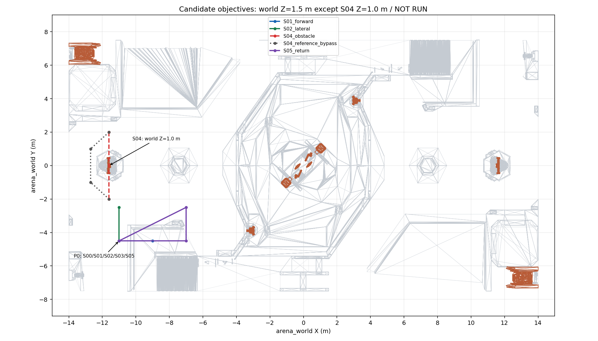

# RMUC2027 场地资产

本目录为从 Windows `RMUC2027_Gazebo` 包复制的独立运行模型；原件保留。模型目录含 82 个文件、214943647 B，SHA256 见 [manifest.json](manifest.json)。视觉三角面 3494668，碰撞三角面 803446；未平移世界原点、未减面或修改碰撞。

```text
rmuc2027/
├── models/rmuc2027_terrain/
│   ├── model.config
│   ├── model.sdf
│   └── meshes/                    # visual_*.stl / collision_*.stl
├── provenance/                    # 上游许可、原始 provenance、转换记录
├── planning/
│   ├── check_candidates.py        # 离线碰撞表面采样；不启动仿真
│   ├── candidate_geometry.json    # 本次候选检查结果
│   └── targets.png                # 目标位置与几何对照图
└── manifest.json                 # 模型文件大小与 SHA256
```

场地模型通过 `model://rmuc2027_terrain` 引用。将本目录的 `models/` 加入 `GZ_SIM_RESOURCE_PATH`；SDF 静态检查另加 `SDF_PATH`。不叠加无限地平面。配套世界为包根 `worlds/rmuc2027.sdf`；目标调试预览为 `worlds/rmuc2027_targets.sdf`（7 个无碰撞可视球，仅调试，不用于感知评估），地图与目标配置为 `config/arena/rmuc2027*.yaml`。CMake 安装清单包含 assets/worlds/config；构建／验收状态见主工程 STATUS。

模型世界坐标单位 m、Z 向上；碰撞网格范围约 X ±14.0025、Y ±8.0041、Z -0.3035～3.4998 m，范围不等于官方飞行边界。地面高度不恒为零；目标图中一般 z=1.5 m、S04 z=1.0 m，均为世界高度。上游自定义侧封口和两套停靠台保留，不标为官方结构或已验收机库。

上游转换包来源、提交和 archive SHA256 见 manifest/provenance。`provenance/UPSTREAM_LICENSE` 为上游仓库附带 MIT 文件；原 CAD 权属及授权范围待确认的原始说明保留在 `provenance/upstream_provenance.json`，不因复制改变其记录。

## 候选目标与几何检查

任务目标定义在 `config/arena/rmuc2027_scenarios.yaml`。所有用例均 `execution_enabled=false`、`NOT RUN`，session 已校验该 schema 并使用 S00 参考悬停点，尚无飞行任务运行器。世界坐标只用于选点；运行目标须从 READY 时测得并冻结的 VIO 位姿／水平航向与相对偏移生成，不从真值求目标。

图中红色虚线表示被现有高障碍阻断的起终点连线，不是下发轨迹。灰色点线是离线旁侧空间对照，也不下发 EGO；绕行轨迹必须由传感器建图和 EGO 生成。紫色是往返用例的分段目标连线，不代表连续可执行路径。



本次检查按 0.1 m 间隔计算候选点到碰撞三角面的距离，使用 0.25 m 检查球半径；该半径不是机体尺寸、控制门限或官方净空要求。直行段最小采样距离约 0.731 m；侧移段 0.885 m；往返各段不低于 0.731 m。绕障直线约 0.012 m，且线段与碰撞表面相交；旁侧几何对照各段约 0.790 m 或更大（距离报告截断到 1 m）。

只检查离散表面距离，不证明网格实体内外、连续扫掠、传感器可见性、动力学或闭环可达。机体参数、接地出生高度、侧移／返程观测覆盖、任务预算与到达保持时间须在运行入口实现时核定。

在源码或安装后的包根执行以下离线检查，输出文件必须不存在；需要系统 NumPy/PyYAML，不启动 Gazebo/PX4：

```bash
PYTHONNOUSERSITE=1 /usr/bin/python3 assets/rmuc2027/planning/check_candidates.py \
  --out /home/waterc/bb_build/gab-map-validation-20261029/layout/geometry-NEW.json
```

## 外观诊断派生

原始模型不添加 UV 或纹理。可选 `gazebo_texture` 从原始视觉网格生成纹理诊断变体，碰撞文件逐字节保留；派生资产及哈希清单位于显式指定的 bb_build 新目录。入口、路径约束与结果边界见[仿真包](../../README.md#可选表面纹理诊断)。变体通过也不能改写原场景结果。
